# District Explorer — Lab Report

**Name:** Muhammad Talha Abdullah Khan
**Roll number:** 537711
**Course:** GIS874 Web GIS, IGIS, NUST  

**Live map:** https://talhakhan366.github.io/webgis-lab-537711/  
**Repository:** https://github.com/Talhakhan366/webgis-lab-537711

---

## 1. Screenshots

Screenshots are in the order they were taken.

**Screenshot 1** — ____  
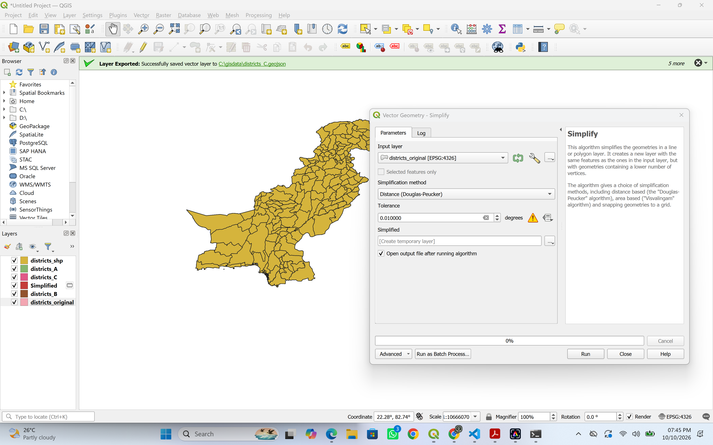

**Screenshot 2** — File sizes of the shapefile and Versions A to D, measured in PowerShell  
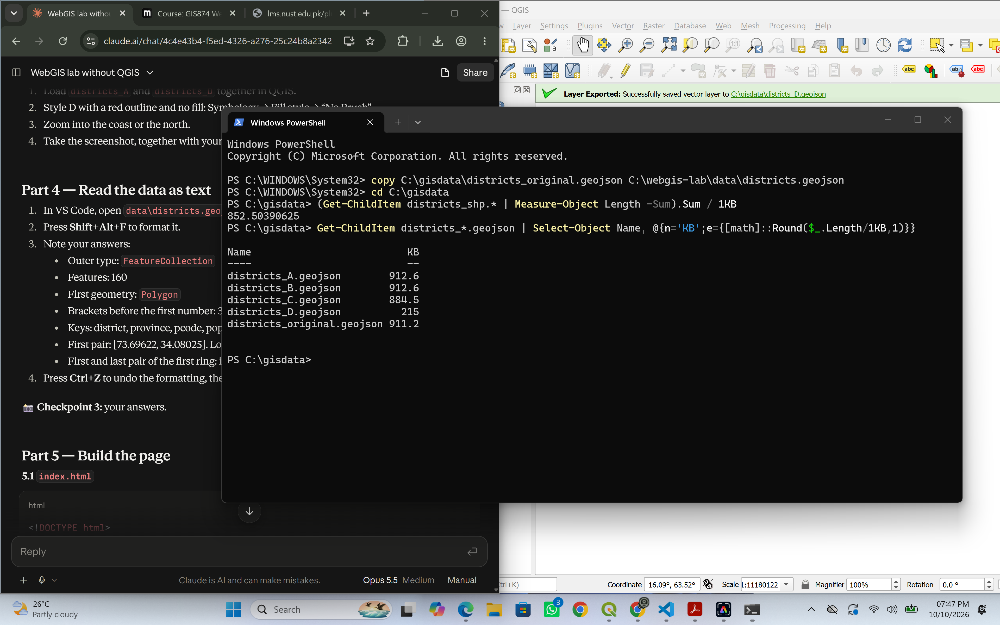

**Screenshot 3** — ____  
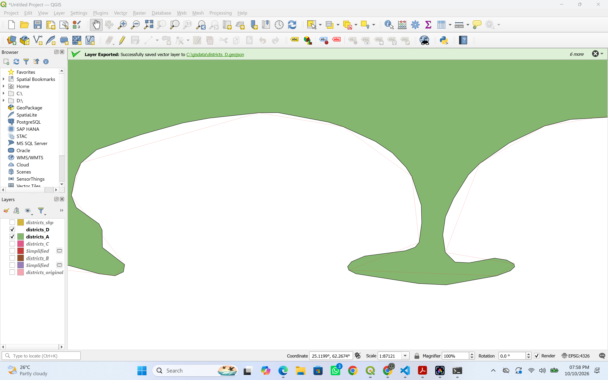

**Screenshot 4** — ____  
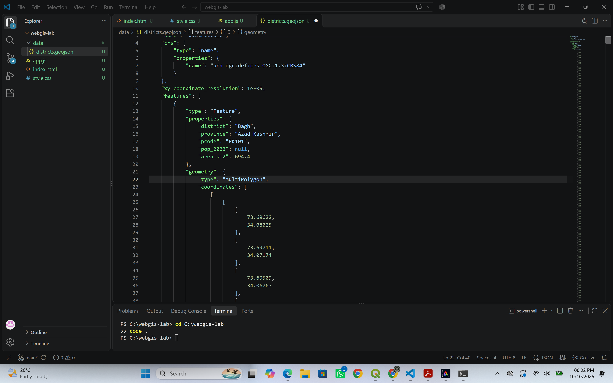

**Screenshot 5** — ____  
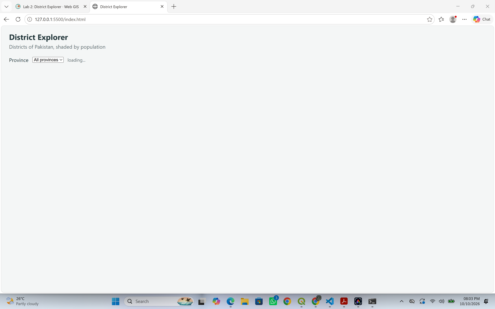

**Screenshot 6** — ____  
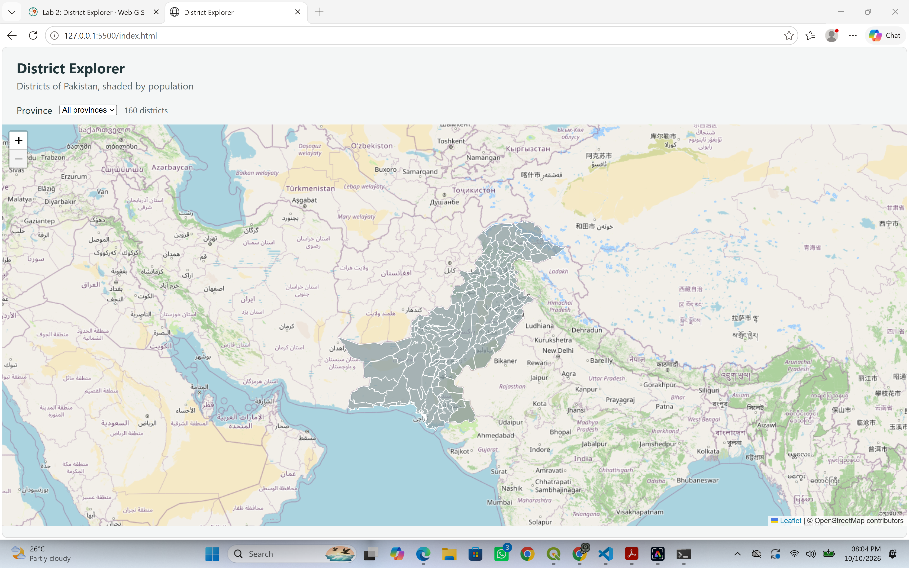

**Screenshot 7** — ____  
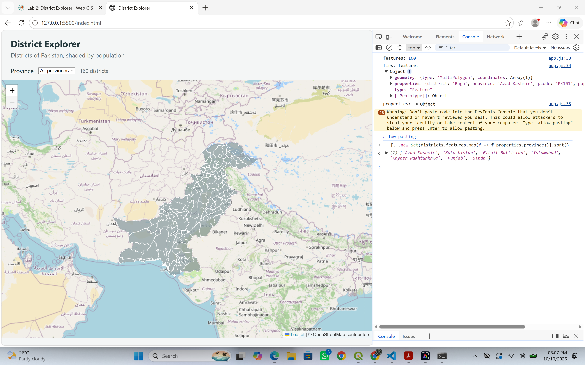

**Screenshot 8** — Network tab: request headers for `districts.geojson` (200 OK, 905,717 bytes)  
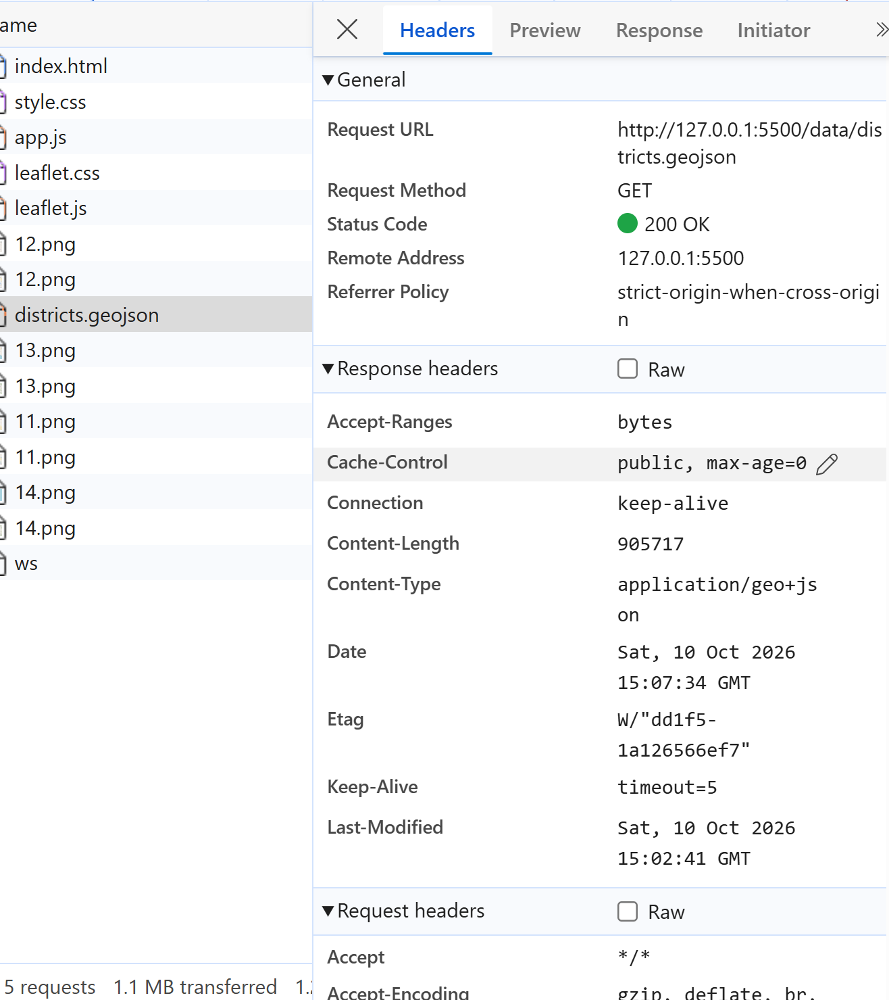

**Screenshot 9** — Network tab without throttling: `districts.geojson` 906 kB in 10 ms, and 8 map tiles  
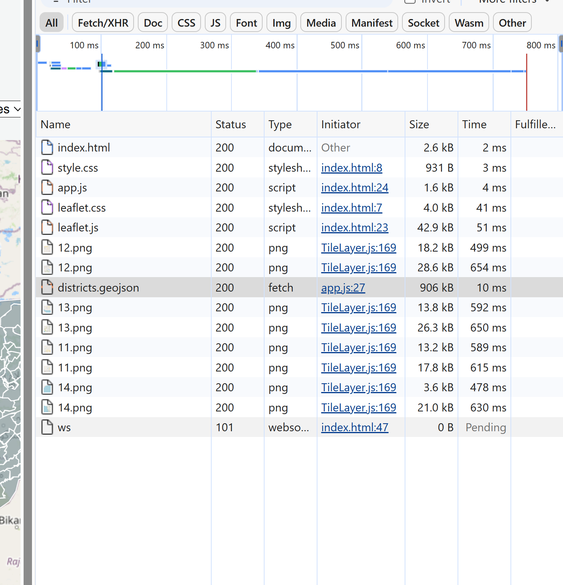

**Screenshot 10** — Network tab, 3G throttling: Version C loaded in 23.18 s  
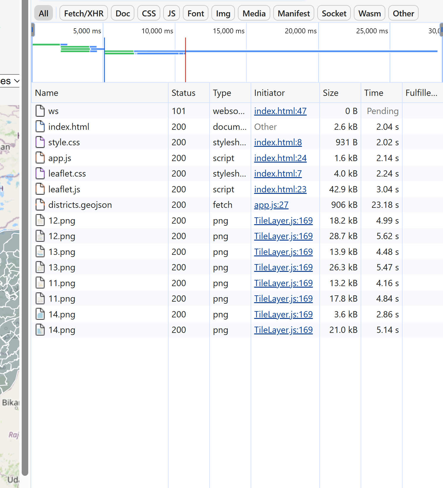

**Screenshot 11** — Network tab, 3G throttling: Version A loaded in 23.76 s  
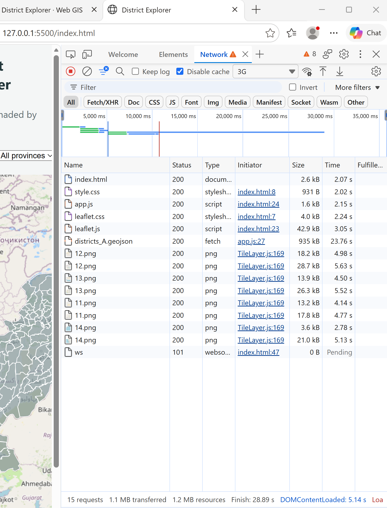

**Screenshot 12** — ____  
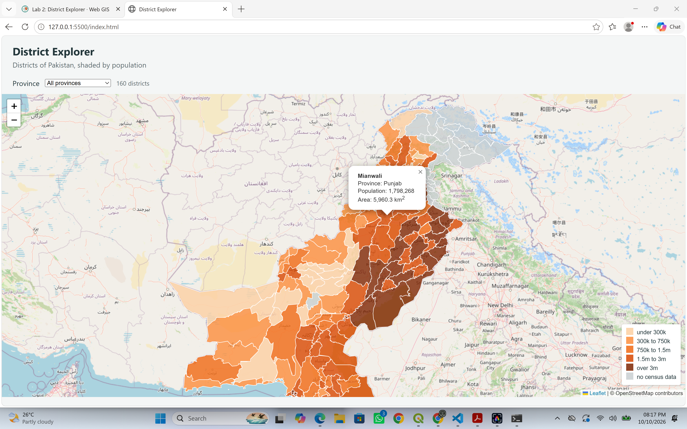

**Screenshot 13** — ____  
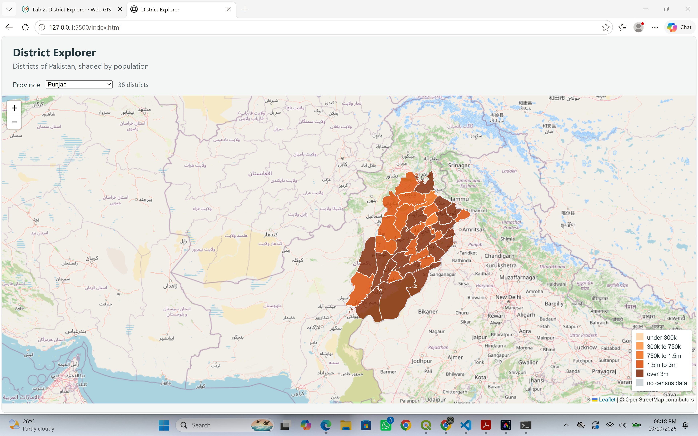

### Reading the GeoJSON as text

- Outermost type: `FeatureCollection`
- Number of features: 160
- Geometry type of the first feature: `Polygon`
- Levels of square bracket before the first number: 3
- Property keys: `district`, `province`, `pcode`, `pop_2023`, `area_km2`
- First coordinate pair: `[73.69622, 34.08025]` (Bagh, Azad Kashmir). The first value is in the 60–77 range and the second in the 24–37 range, so the order is longitude, latitude, which is correct.
- The first and last pairs of the first ring are identical, so the ring closes.

---

## 2. File size measurements

| Version | What was done | Size (KB) | % of A |
|---|---|---|---|
| Shapefile | .shp + .shx + .dbf + .prj + .cpg | 852.5 | 93.4 |
| A | Straight conversion | 912.6 | 100.0 |
| B | Precision 5 | 912.6 | 100.0 |
| C | Simplified 100 m, precision 5 | 884.5 | 96.9 |
| D | Simplified 1 km, precision 5 | 215.0 | 23.6 |

**Method.** The data was supplied on LMS as GeoJSON rather than as a shapefile. A shapefile was produced from it in QGIS (Save Features As, ESRI Shapefile, EPSG:4326), and only its five component files were added together. Versions A to D were exported from QGIS in EPSG:4326. Sizes were read in PowerShell with `Get-ChildItem`.

**Observations.**

- A and B are the same size. The supplied file was already rounded to five decimal places, so setting `COORDINATE_PRECISION` to 5 removed nothing.
- C is only about 3% smaller than A. The supplied file (about 0.9 MB) is far smaller than the published 27.7 MB GeoJSON, so it was most likely simplified before it was shared. A 100 m tolerance therefore found few extra vertices to remove.
- D is about 76% smaller. At a 1 km tolerance a large share of vertices is dropped, and the borders are visibly coarser.
- The shapefile is smaller than the GeoJSON, which matches the published download sizes (24.3 MB for the shapefile bundle against 27.7 MB for GeoJSON). A shapefile stores coordinates as binary numbers. GeoJSON writes every coordinate as text and repeats brackets, commas and property names for every feature.

---

## 3. Load times

Measured in the browser Network tab with **Disable cache** ticked.

| File | Size | No throttling | 3G throttled |
|---|---|---|---|
| Version C (`districts.geojson`) | 906 kB | 10 ms | 23.18 s |
| Version A (`districts_A.geojson`) | 935 kB | not measured | 23.76 s |
| Whole page under 3G | 1.1 MB, 15 requests | — | finished in 28.89 s |

Without throttling, the GeoJSON loaded in 10 ms because Live Server sends it from the local machine. The eight basemap tiles took about 0.5 to 0.65 s each, because they come over the internet from OpenStreetMap. Under 3G the data file alone took over 20 seconds. Because C is only slightly smaller than A, it saved only about 0.6 s. Version D, at roughly a quarter of the size, would have loaded much faster on a mobile connection.

---

## 4. Classification

Five classes with breaks at **300,000, 750,000, 1.5 million and 3 million** people, plus a separate grey class for districts with no census value.

The breaks roughly double from one class to the next, which suits district populations in Pakistan: most districts hold a few hundred thousand to about 1.5 million people, while a handful of large urban districts hold several million. Equal-interval breaks would have put almost every district in the lowest class. Districts in Azad Kashmir and Gilgit-Baltistan, which the 2023 census did not cover, are shown in grey so that missing data is not read as low population.

---

## 5. Coordinate system comparison

Areas were computed in QGIS with `area($geometry) / 1000000` on two copies of the layer, one in EPSG:3857 (Web Mercator) and one in EPSG:32643 (UTM zone 43N). Latitude is the district centroid, from `y(centroid($geometry))`. The predicted inflation is 1 / cos²(latitude).

| District | Latitude | 3857 km² | UTM km² | Measured difference | Predicted difference |
|---|---|---|---|---|---|
| Karachi South | 24.894 | 619.96 | 516.02 | +20.1% | +21.5% |
| Hyderabad | 25.341 | 1252.90 | 1029.20 | +21.7% | +22.4% |
| Multan | 29.939 | 4874.60 | 3655.94 | +33.3% | +33.2% |
| Islamabad | 33.672 | 1306.03 | 902.09 | +44.8% | +44.4% |
| Lower Chitral | 35.887 | 9278.16 | 6085.14 | +52.5% | +52.3% |

**1. Does the difference grow or shrink going north?**  
It grows steadily, from 20.1% at Karachi South (24.9°N) to 52.5% at Lower Chitral (35.9°N). Web Mercator stretches the map more the further a place is from the equator.

**2. Predicted against measured.**  
For Islamabad, at 33.672°N: cos(33.672°) = 0.832, so 1 / cos²(33.672°) = 1 / 0.693 = **1.444**, a predicted inflation of 44.4%. The measured difference is 44.8%, which agrees to within half a percentage point. Multan and Lower Chitral agree just as closely.

Karachi South and Hyderabad measure about one percentage point below the prediction. Both lie in UTM zone 42N, not 43N. Measured in zone 43N, which is centred on 75°E, they are about 7 to 8 degrees from the central meridian, so the UTM figure itself is about 1.5% too large and the gap looks smaller. Multan, at about 71.5°E, is much closer to that meridian and is barely affected.

**3. Which figure to report.**  
The UTM figure. UTM is a projected system designed for measurement and keeps area distortion very small within its zone. The Web Mercator figure is inflated by 20 to 52% across Pakistan and should never be reported. For the most accurate results, each district should be measured in its own UTM zone: 42N for Sindh, southern Punjab and most of Balochistan, 43N for the north and east.

## 6. Answers to the questions

**1. Version D is far smaller than A. Give one situation in which D would be the wrong choice.**  
D would be wrong for any map viewed at district or local scale, for example a flood-response map where a user zooms in to see which villages fall inside a district. At a 1 km tolerance, boundaries cut across towns and rivers, so a settlement near a border could appear in the wrong district. D would also be wrong for any calculation that depends on boundary shape, such as areas or perimeters.

**2. One request for the GeoJSON and dozens for tiles. Explain the difference.**  
The GeoJSON is vector data. The whole file is sent once, and the browser draws it itself at every zoom level. The basemap is raster tiles: pre-rendered 256 × 256 pixel images. The browser requests only the tiles covering the current view at the current zoom level, and requests new ones whenever the user pans or zooms. In my measurements the GeoJSON came from the local server in 10 ms, while each tile came over the internet from OpenStreetMap in about half a second.

**3. Why does the map container need a height when the heading does not?**  
The heading contains text, and the browser sizes it to fit that text. The map `div` is empty when the page loads. Leaflet fills it later with JavaScript, so it has nothing to give it a height. An empty `div` is zero pixels tall, and Leaflet draws a zero-pixel map with no error. The CSS rule `height: calc(100vh - 150px)` gives it a real height.

**4. `draw` removes the existing layer before adding a new one. What would go wrong without it?**  
`L.geoJSON(...).addTo(map)` adds a layer; it does not replace one. Without `removeLayer`, every change of province would put a new layer on top of the old ones. All districts would stay visible underneath the filtered ones, so the filter would appear not to work. The map would also get slower with each change as more layers built up.

**5. A classmate's districts all appear in the same colour. Two possible causes and how to tell them apart.**  
- **Cause 1:** the population field name in the code does not match the data, for example `pop_2023` in the code but `population` in the file. Every value is then `undefined`, so every district is grey.  
- **Cause 2:** the population values are stored as text that cannot be converted to a number, such as `"1,234,567"` or `"NA"`. Every comparison is false, so every district falls through to the lowest class, the palest orange.  
- **How to tell them apart:** first, the colour itself (grey points to cause 1, pale orange to cause 2). Then run `districts.features[0].properties` in the Console. If the field is missing or named differently, it is cause 1. If it is present but shown in quotes, it is cause 2.

**6. Double-clicking `index.html` shows the basemap but not the districts. Why?**  
Double-clicking opens the page from the file system, with an address starting `file:///`. For security, browsers block `fetch` requests made from `file:///` pages, so the request for `data/districts.geojson` fails and the districts never load. The basemap still appears because its tiles come from an `https://` server on the internet, which the browser allows. Serving the page through Live Server (`http://127.0.0.1:5500`) fixes it.